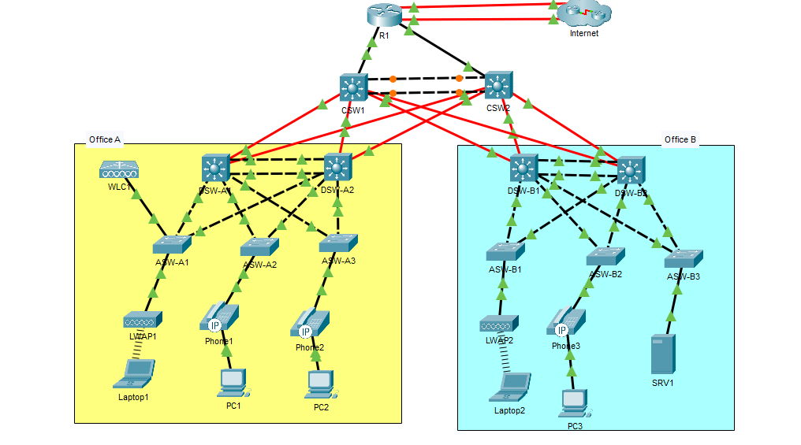
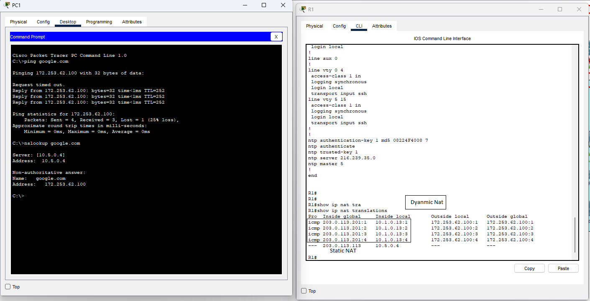
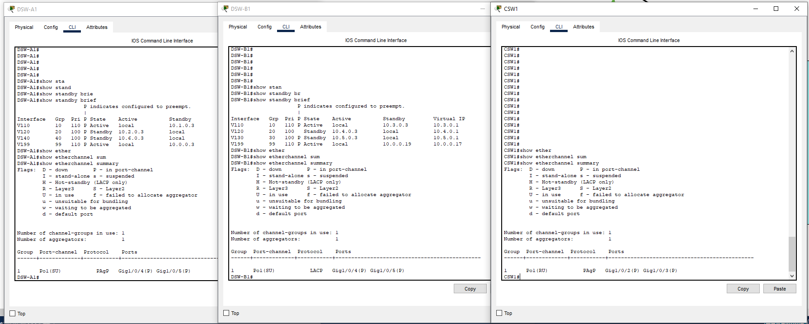
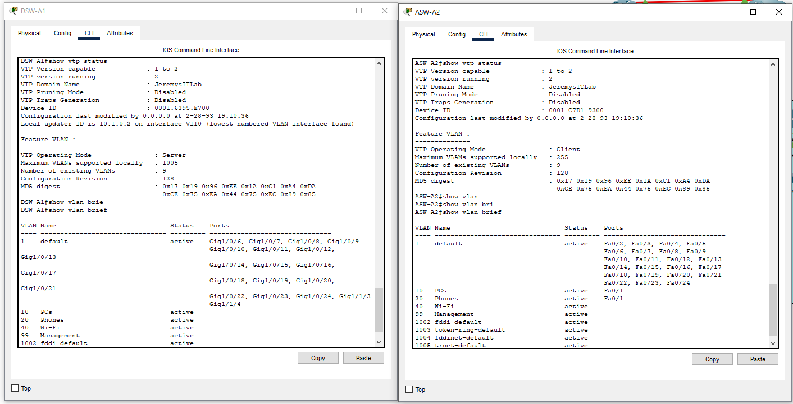
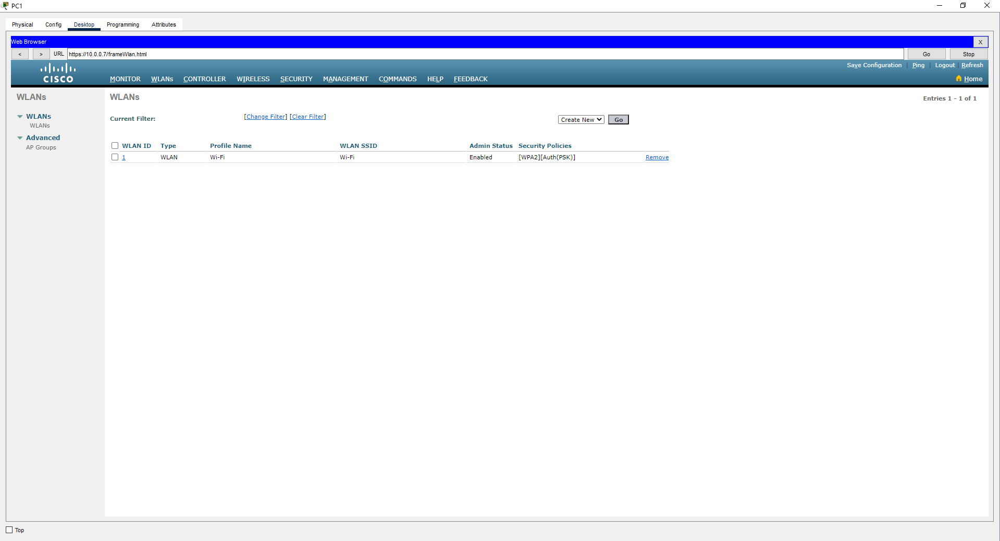
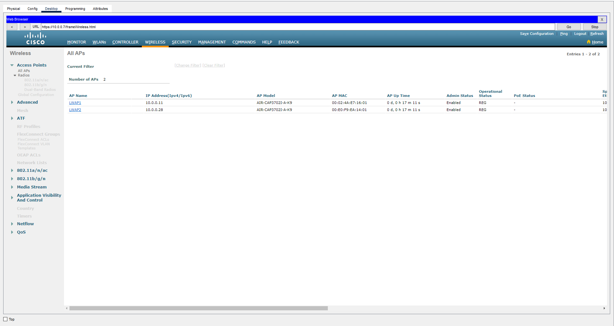
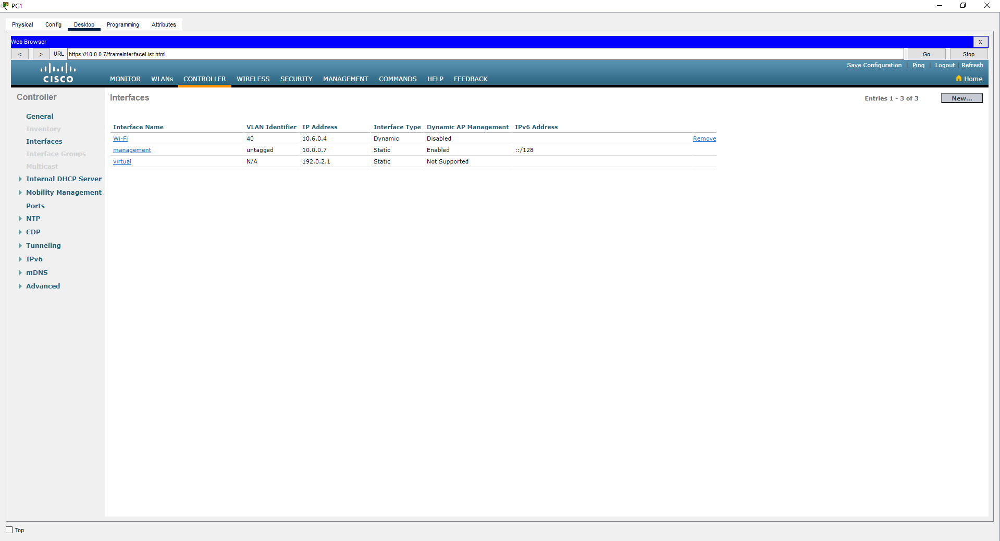

# 🧠 CCNA Mega Lab (Jeremy’s IT Lab)

---

## 🙏 Homage  

This **CCNA Mega Lab** was originally created by **[Jeremy’s IT Lab](https://www.jeremysitlab.com/)**.  
You can find his incredible free full CCNA video course on YouTube here:  
▶️ **[Jeremy’s IT Lab - CCNA Full Course Playlist](https://www.youtube.com/watch?v=H8W9oMNSuwo&list=PLxbwE86jKRgMpuZuLBivzlM8s2Dk5lXBQ)**  

I *highly recommend* Jeremy’s content — his educational material was instrumental in helping me pass the **CCNA** myself.  
If you’re studying for the CCNA, his explanations and lab exercises are some of the best available for free.

---

## 💬 Description  

The **CCNA_MEGA_LAB** by Jeremy’s IT Lab is a massive, hands-on configuration lab that can takes several hours to complete.  

> *"This lab covers a complete network configuration from zero, including topics like IPv4 and IPv6, static routes, VLANs, spanning tree, OSPF, EtherChannel, DHCP, DNS, NAT, SSH, security features, wireless, and more – everything on the CCNA exam!"*  
> — *Jeremy’s IT Lab*  

This repository contains my version of the lab, including notes, configurations, and scoring screenshots from my run-through. If you would like to complete the lab yourself, please visit the links provided in the Homage section.

---

## 📊 Scoring  

This lab includes a built-in **percentage-based scoring mechanism** that updates your completion score every time you save the configuration (using `copy running-config startup-config` or `write memory`).  

I personally finished the lab at **98%**, which is due to a few minor configuration preferences:  

- In the **HSRP** section, Jeremy uses standby groups **1, 2, 3**, etc.  
  I used the **actual VLAN numbers** for my standby groups instead.  
- Jeremy configured a **priority of 105**, while I used **110**.  

---

## 🌐 Network Topology  

The **LAN network** consists of:  
- 🖧 Six Access Switches  
- 🏢 Four Distribution Switches  
- 🧩 Two Core Switches  
- 🌍 One Edge Router  

The **WLAN** includes:  
- 📡 One Wireless LAN Controller (**WLC**)  
- 📶 Two managed **Lightweight Access Points (LWAPs)**  

**Network Topology Diagram:**  


---
## 🧪 Verification & Testing  
### 🖥️ Updated Image on R1  
[View Configuration](https://github.com/mahmoodsaeedM/CCNA-MEGA-Project-/blob/main/Verification_Testing/IMAGE_UPDATED_FLASH.txt)

### 📋 DHCP Pools  
[View DHCP Pools](https://github.com/mahmoodsaeedM/CCNA-MEGA-Project-/blob/main/Verification_Testing/IP_DHCP_POOLS.txt)

### 🌍 IP Routing (IPv4 & IPv6)  
- [OSPF Database & IPv4 Routes](https://github.com/mahmoodsaeedM/CCNA-MEGA-Project-/blob/main/Verification_Testing/IP_DHCP_POOLS.txt)  

### 🌐 NAT (Network Address Translation)  


### 🔗 EtherChannel & HSRP  


### 🔄 VTP (Client/Server)  


### 🔒 Security (ARP Inspection / DHCP Snooping / Port Security)  
- [ARP & DHCP Snooping Verification](https://github.com/mahmoodsaeedM/CCNA-MEGA-Project-/blob/main/Verification_Testing/ARP_INS_DHCP_SNOOP_VERIFICATION.txt)  
- [Port Security (Access Ports)](https://github.com/mahmoodsaeedM/CCNA-MEGA-Project-/blob/main/Verification_Testing/PORT_SECURITY_ACCESSPORTS.txt)

### 📡 WLC Settings  
  
  


---

## 📁 Repository Structure

The repository is organized to make it easy to follow the lab, view configurations, diagrams, and testing results.

```text
CCNA_MEGA_LAB/
├── Configs/                           # Device configuration files
│   ├── Access_Switches/                # All access switch configs
│   │   ├── ASW-A1.txt
│   │   ├── ASW-A2.txt
│   │   ├── ASW-A3.txt
│   │   ├── ASW-B1.txt
│   │   ├── ASW-B2.txt
│   │   └── ASW-B3.txt                  
│   ├── Core_Switches/                  # Core switch configs
│   │   ├── CSW1.txt
│   │   └── CSW2.txt
│   ├── Distro_Switches/                # Distribution switch configs
│   │   ├── DSW-A1.txt
│   │   ├── DSW-A2.txt
│   │   ├── DSW-B1.txt
│   │   └── DSW-B2.txt                         
│   └── Edge_Router/                     # Edge router configs
│       └── R1.txt
├── Diagrams/                           # Visual diagrams of the lab topology
│   └── Network_Topology.png            # Complete network topology diagram
├── Lab_Score/                          # Lab scoring and results
│   ├── LAB_SCORING.PNG                 # Screenshot showing lab completion percentage
│   └── INCORRECT_ITEMS.PNG             # Items flagged as incorrect in scoring
├── PKT/                                # Packet Tracer files
│   └── CCNA_MEGA_LAB.pkt               # Full Packet Tracer lab file
└── Verification_Testing/               # Verification outputs and screenshots for testing
    ├── IMAGE_UPDATED_FLASH.txt                 # Updated R1 flash image
    ├── IP_DHCP_POOLS.txt                       # DHCP pool configurations
    ├── OSPF_DATABASE_WITH_IP_ROUTE.txt         # IPv4 OSPF database and routes
    ├── IPV6_Route.txt                          # IPv6 routing table
    ├── NAT_W_DNS.png                            # NAT configuration with DNS
    ├── L2_AND_L3_ETHER_AND_HSRP.PNG           # EtherChannel and HSRP setup
    ├── VTP_V2_SERVER_CLIENT.PNG               # VTP Client/Server configuration
    ├── ARP_INS_DHCP_SNOOP_VERIFICATION.txt    # ARP inspection & DHCP snooping verification
    ├── PORT_SECURITY_ACCESSPORTS.txt          # Port Security configurations for access ports
    ├── WLAN_PROFILE_WIFI_ESS.PNG              # WLAN ESS profile configuration
    ├── WLC_APS.PNG                             # WLC Access Points configuration
    └── WLC_INTERFACES.PNG                      # WLC interface settings

```

---

## 🧰 Additional Notes  

- This lab is designed for **Cisco Packet Tracer** environment.  
- You’ll gain hands-on practice in nearly every **CCNA exam domain**.  
- It’s a great final review lab before taking the **Cisco CCNA (200-301)** exam.  

---

## 🎓 Credits  

**Original Lab Creator:** [Jeremy’s IT Lab](https://www.jeremysitlab.com/)  
*Modified & Documented By:** [Mahmoud Saeed](https://github.com/mahmoodsaeedM) * 
